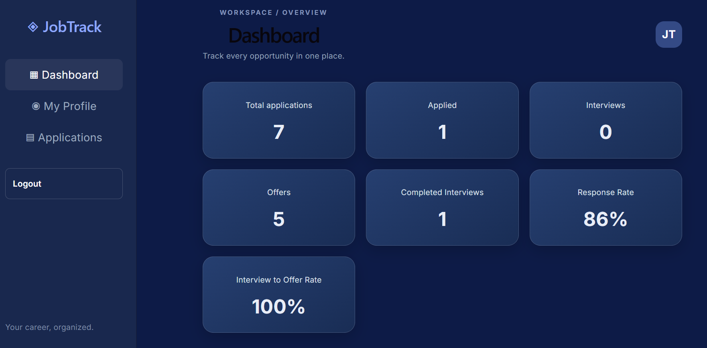
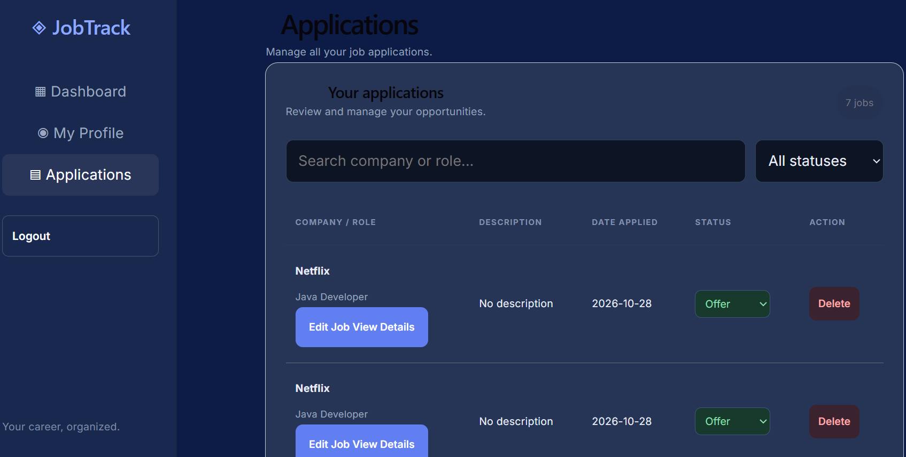
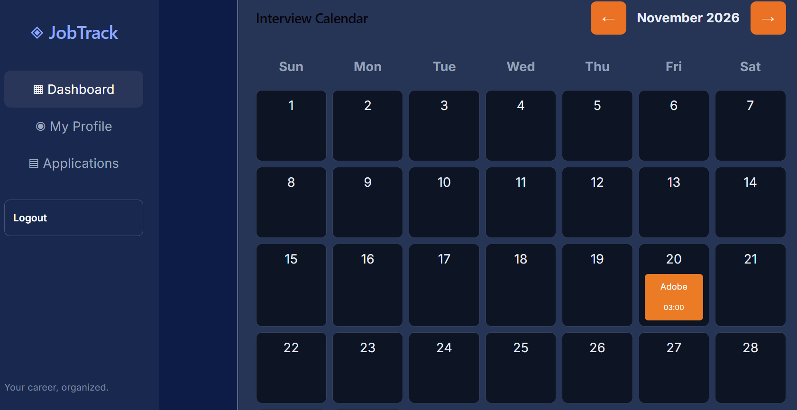
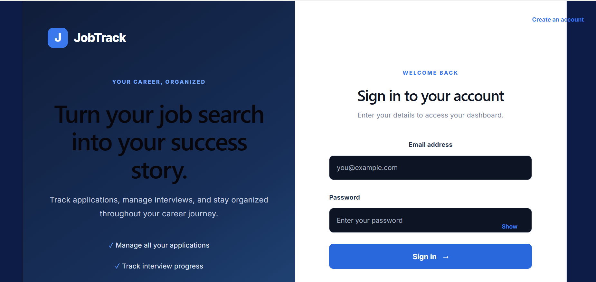

# 🚀 JobTrack — Smart Job Application Tracker

JobTrack is a full-stack web application that helps users organize job applications, track application progress, manage interviews, and monitor their job search through an interactive dashboard.

## ✨ Features

- 🔐 User Registration and Login
- 🔑 JWT Authentication and Password Security
- 📊 Interactive Dashboard and Analytics
- 💼 Add, Edit, Delete Job Applications
- 🔍 Search Applications by Company or Role
- 🏷️ Filter Applications by Status
- 📅 Interview Calendar
- ✅ Mark Interviews as Completed
- 📈 Interview Completion Rate
- 👤 User Profile Management
- 🔒 Change Password
- 📱 Responsive UI for Mobile and Desktop

## 🛠️ Tech Stack

### Frontend
- React.js
- JavaScript
- HTML5
- CSS3
- Recharts

### Backend
- Java 21
- Spring Boot
- Spring Security
- Spring Data JPA
- REST APIs
- JWT Authentication

### Database
- MySQL

### Tools
- Visual Studio Code
- Git and GitHub
- Maven
- Postman / Thunder Client

## 📁 Project Structure

```text
JobTrack/
├── frontend/
│   ├── src/
│   ├── package.json
│   └── ...
│
├── jobtrack/
│   ├── src/
│   ├── pom.xml
│   └── ...
│
├── .gitignore
└── README.md
```

## ⚙️ Installation and Setup

### 1. Clone the repository

```bash
git clone https://github.com/jrtiger2005/JobTrack.git
cd JobTrack
```

### 2. Backend Setup

Open the backend folder:

```bash
cd jobtrack
```

Configure your MySQL database and credentials in:

`src/main/resources/application.properties`

Then run:

```bash
.\mvnw.cmd clean install
.\mvnw.cmd spring-boot:run
```

Backend runs at:

`http://localhost:8080`

### 3. Frontend Setup

Open another terminal:

```bash
cd frontend
npm install
npm run dev
```

Frontend runs at:

`http://localhost:5173`

## 🔐 Authentication

JobTrack uses JWT-based authentication to secure protected API endpoints.

- Secure user registration and login
- BCrypt password hashing
- Token-based authorization
- User-specific job applications


## 📸 Screenshots

### 1. Dashboard


### 2. Applications Management


### 3. Interview Calendar


### 4. jobtrack Sign in page

## 🚀 Future Improvements

- Email notifications for upcoming interviews
- Job application reminders
- Resume management
- Advanced analytics
- Cloud deployment

## 👨‍💻 Author

**Aman Singh**

- GitHub: [jrtiger2005](https://github.com/jrtiger2005)
- LinkedIn: [Aman Singh](https://www.linkedin.com/in/aman-singh-269a44314/)

---

⭐ If you find JobTrack useful, consider giving this repository a star!
